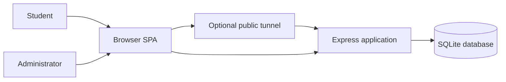
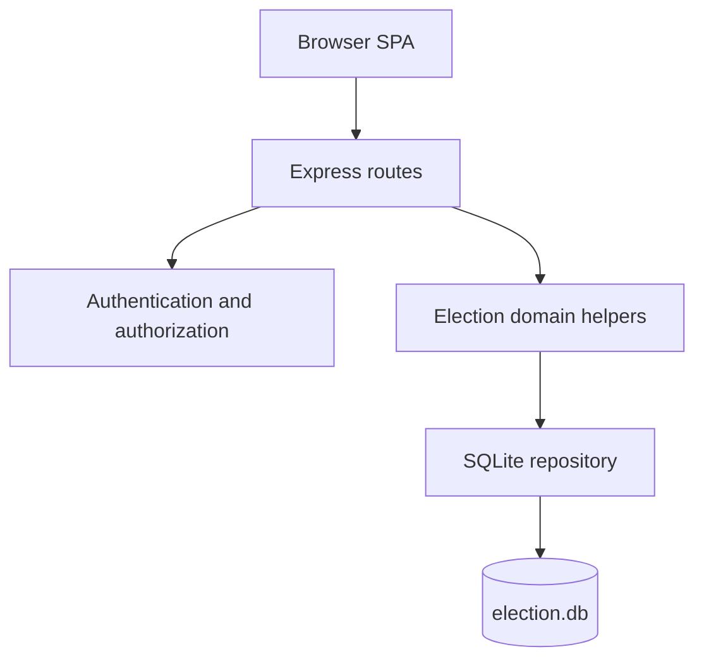
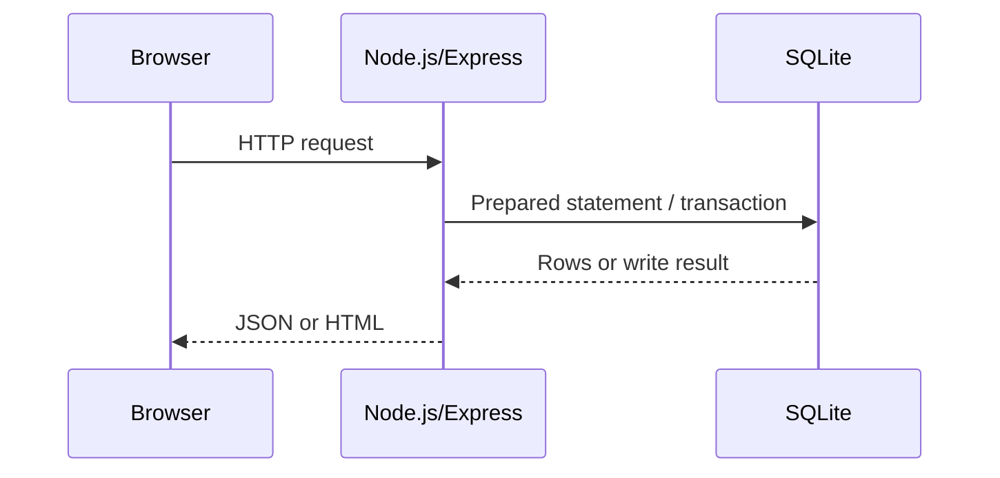
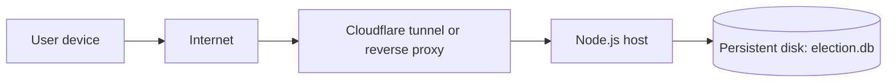

# Architecture Description

## 1. Architectural goals

The architecture prioritizes:

- correctness of election rules and vote counts;
- clear separation between public, student, and administrator capabilities;
- a small deployment footprint;
- testability without external services;
- incremental extension without rewriting the data model.

## 2. System context



The application is a two-tier client-server system. The browser is the client; the Express process is the server; SQLite is embedded in the server process. A Cloudflare tunnel is an optional deployment adapter, not part of the domain.

## 3. The 4+1 views

### 3.1 Logical view



Logical components:

- **Presentation** — `index.html`, `app.js`.
- **HTTP/API** — `server/app.js` and `server/routes/*.js`.
- **Security** — `server/auth.js`.
- **Domain** — `server/helpers.js`, `server/routes/admin.js` lifecycle logic.
- **Persistence** — `server/db.js` and the SQL schema.
- **Configuration and demo data** — `server/seed.js`, environment variables.

### 3.2 Process view

At runtime there are two main processes:

1. **Browser process** — runs the SPA, handles hash routing, form submission, and rendering.
2. **Node.js process** — runs Express, opens SQLite with WAL mode, serves static files and JSON APIs.



SQLite connections are process-local. WAL mode and a busy timeout reduce write contention. Multi-process deployment would require revisiting this choice.

### 3.3 Development view

```text
app.js / index.html        frontend
server/app.js              application assembly
server/routes/*.js         HTTP adapters
server/helpers.js          domain helpers and serializers
server/auth.js             security helpers
server/db.js               schema, connection, time, transactions
server/seed.js             demo data
test/*.test.js             automated tests
docs/*.md                  engineering documentation
```

Dependency direction is inward: routes depend on helpers, auth, and database modules; helpers depend on the database module; the frontend depends only on the HTTP API.

### 3.4 Physical/deployment view



Production requirements:

- HTTPS termination at the edge or reverse proxy.
- A persistent volume for `data/election.db`.
- `NODE_ENV=production`, `DEMO_MODE` unset or `false`.
- Backups of the database file and WAL sidecars.
- A stable tunnel or platform instead of a Quick Tunnel.

### 3.5 Scenarios (+1)

- **Vote casting** — see `docs/system-models.md` sequence 5.
- **Result publishing** — see `docs/system-models.md` sequence 6.
- **Nomination review** — administrator opens pending list, approves, and the candidate becomes ballot-eligible.

## 4. Architectural patterns

### Layered architecture

The application uses a pragmatic layered structure: presentation, HTTP/API, domain helpers, and persistence. It is not a strict layered architecture because routes call the database directly for simple queries, which reduces ceremony for a small system.

**Trade-off:** simple and fast to develop; some domain rules are duplicated across routes.

### Model-View-Controller on the client

`state` and API loaders act as the model, page functions and `paint()` act as the view, and global event handlers act as the controller.

**Trade-off:** no framework dependency, but `app.js` is large and should be split when the team grows.

### Repository-style persistence

All schema and connection management live in `server/db.js`; SQL is executed through prepared statements in routes and helpers. This is a lightweight repository approach rather than a full repository abstraction.

**Trade-off:** direct SQL is transparent and fast; swapping databases would require a new persistence layer.

### Client-server

The browser and server communicate through JSON APIs. The server is the authority for authentication, eligibility, round windows, vote uniqueness, and result publication.

**Trade-off:** simple security boundary; the client cannot be trusted, which is why all checks are repeated server-side.

### Transaction script for publishing

Result publication runs inside a `BEGIN IMMEDIATE` transaction that deletes old entries, inserts the snapshot, and marks the election published. This keeps the published result consistent.

## 5. Architectural decisions

| ID | Decision | Rationale | Consequence |
|---|---|---|---|
| ADR-01 | Use SQLite via `node:sqlite` | Zero external services, easy coursework deployment, durable file storage | Single-writer limits and manual backups |
| ADR-02 | Use Express 5 | Small API surface, familiar routing, easy middleware composition | Fewer built-in conventions than a full framework |
| ADR-03 | Use a vanilla SPA | No build step and no framework dependency | Large `app.js`; manual DOM rendering |
| ADR-04 | Use server-side sessions with HTTP-only cookies | Revocable sessions and no token exposure to JavaScript | Requires session storage and cleanup |
| ADR-05 | Store a frozen result snapshot | Published results must not change if votes or candidates change later | Duplicate data by design |
| ADR-06 | Enforce one vote per round in the database | Application checks alone are race-prone | A failed insert must be mapped to a user-friendly error |
| ADR-07 | Keep demo seeding out of production | Demo accounts have known passwords | Production must run an explicit seed or admin bootstrap |
| ADR-08 | Use a stage transition graph | Prevents accidental jumps such as Draft to Results published | Administrators must follow the lifecycle order |

## 6. Quality-attribute mapping

| Quality attribute | Architectural support |
|---|---|
| Performance | Prepared statements, indexed foreign keys, single process, no network database hop |
| Security | Scrypt password hashing, HTTP-only cookies, origin check, role guards, parameterized SQL |
| Reliability | Database uniqueness constraints, transactions, WAL, frozen results |
| Maintainability | Small modules, shared helpers, documentation, CI |
| Testability | `createApp()` factory, temporary database path, API-level tests |
| Portability | Node.js-only runtime, no native database server |
| Privacy | Public APIs expose approved candidates and published results only |
| Auditability | Administrator actions recorded in `audit_log`; result snapshots with timestamps and eligible-voter counts |

## 7. Known architectural risks

1. **`eligible_group` is not enforced.** The field is descriptive; per-election eligibility comes from the voter roll, and open elections rely on account-level eligibility.
2. **Self-registration grants eligibility.** A production system needs an electoral-roll import or administrator approval.
3. **Ballot secrecy is limited.** Votes store both voter and candidate IDs in the same row.
4. **Audit coverage is partial.** Administrator actions are written to `audit_log`, but voter and background events are not recorded and entries are not tamper-evident.
5. **Schema migrations are additive only.** Startup applies `ALTER TABLE ... ADD COLUMN`; there is no versioned migration history or rollback.
6. **Quick Tunnel is ephemeral.** Public links change and may fail.
7. **Single-process login throttle.** Limits are not shared across instances.
