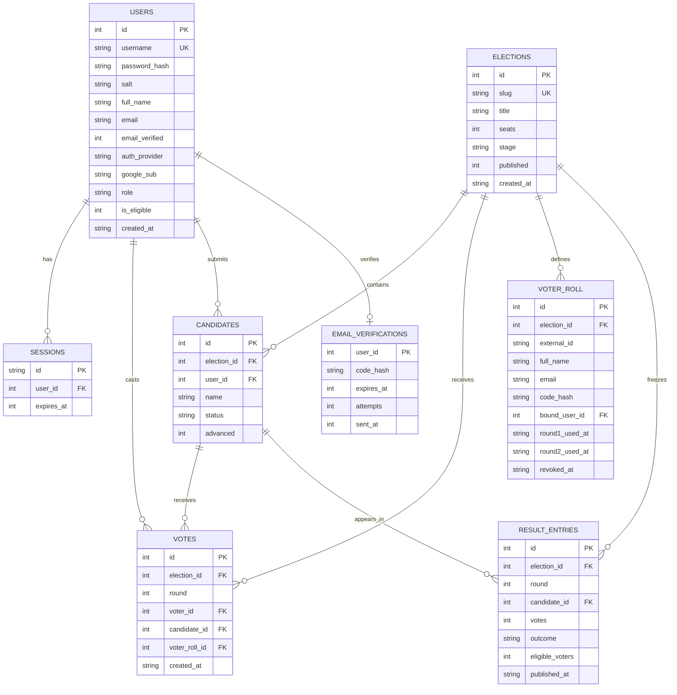

# Design and Implementation

## 1. Design approach

The system uses object-oriented and transactional design ideas without a heavy framework:

- **Entities** map to database tables and serialized API objects.
- **Domain helpers** centralize election status, candidate serialization, vote counting, and result summaries.
- **Route modules** are HTTP adapters that validate input and coordinate helpers.
- **The browser SPA** uses a small state object and page functions instead of a component framework.

Design and implementation are interleaved: the schema, routes, and UI evolved together, with tests protecting the main election rules.

## 2. Data model

Key constraints:

- `users.username` is unique and case-insensitive.
- `users.email` is unique case-insensitively when present; `google_sub` is unique when present.
- `votes` has `UNIQUE (election_id, round, voter_id)`.
- `voter_roll` is unique per election by external ID, email and code hash.
- `result_entries` has `UNIQUE (election_id, round, candidate_id)`.
- Foreign keys use `ON DELETE CASCADE` or `SET NULL` where appropriate.
- `elections.stage`, `entry_mode`, `round_mode`, and user roles use `CHECK` constraints.

## 3. Module responsibilities

| Module | Responsibility | Key exports |
|---|---|---|
| `server/db.js` | Schema, connection, WAL, foreign keys, transactions, time conversion | `initDb`, `getDb`, `closeDb`, `now`, `nowIso`, `toIso`, `transaction` |
| `server/auth.js` | Password hashing, sessions, guards, origin checks, validation | `hashPassword`, `verifyPassword`, `hashEmailCode`, `attachUser`, `requireAuth`, `requireAdmin`, `validateEmail` |
| `server/google.js` | Google OAuth, PKCE, ID-token verification, account linking | `googleConfigured`, `oauthClient`, `pkcePair`, `findOrCreateGoogleUser` |
| `server/mailer.js` | Resend/console/test email delivery | `sendVerificationEmail`, `sendVoterCodeEmail`, `testCodeFor` |
| `server/voter-codes.js` | One-time code generation and HMAC hashing | `generateVoterCode`, `hashVoterCode`, `normalizeCode` |
| `server/helpers.js` | Serialization, candidate selection, status derivation, vote counting, result summaries | `serializeElection`, `serializeCandidate`, `countVotes`, `resultSummary`, `electionStatus`, `publicElectionBySlug` |
| `server/routes/auth.js` | Registration, email verification, Google login, logout, session, demo admin | Router |
| `server/routes/elections.js` | Public election, candidate, result, and personal vote APIs | Router |
| `server/routes/nominations.js` | Nomination creation and editing | Router |
| `server/routes/votes.js` | Vote casting and personal vote lookup | Router |
| `server/routes/admin.js` | Election lifecycle, candidate review, counting, publishing | Router |
| `app.js` | SPA routing, state, API calls, rendering, event handling | Browser script |

## 4. API design

### Public and voter APIs

| Method | Path | Purpose |
|---|---|---|
| `GET` | `/api/health` | Health check |
| `GET` | `/api/elections` | List elections |
| `GET` | `/api/elections/:slug` | Election detail and approved candidates |
| `GET` | `/api/elections/:slug/candidates` | Candidates, optionally by round |
| `GET` | `/api/elections/:slug/results` | Published results only |
| `GET` | `/api/results` | All published results |
| `GET` | `/api/my-votes` | Authenticated voter's vote history |
| `GET` | `/api/nominations/mine` | Authenticated user's nomination |
| `GET` | `/api/status` | Voting eligibility and status |
| `POST` | `/api/elections/:slug/nominations` | Submit a nomination |
| `PUT` | `/api/nominations/:id` | Edit a nomination |
| `POST` | `/api/elections/:slug/votes` | Cast a vote |
| `GET` | `/api/elections/:slug/my-vote` | Vote for a specific round |

### Authentication APIs

| Method | Path | Purpose |
|---|---|---|
| `GET` | `/api/auth/session` | Current user, demo mode, Google/email configuration |
| `POST` | `/api/auth/register` | Create an unverified account and email a code |
| `POST` | `/api/auth/verify-email` | Verify the email code and create a session |
| `POST` | `/api/auth/resend-verification` | Rotate and resend an email code |
| `POST` | `/api/auth/login` | Create a session; blocked until email is verified |
| `GET` | `/api/auth/google/start` | Start Google OAuth with state and PKCE |
| `GET` | `/api/auth/google/callback` | Verify Google identity and create/link the account |
| `POST` | `/api/auth/logout` | Destroy the session |
| `POST` | `/api/auth/demo-admin` | Demo login, only when `DEMO_MODE=true` |
| `GET` | `/api/auth/me` | Authenticated user |

### Administrator APIs

| Method | Path | Purpose |
|---|---|---|
| `GET` | `/api/admin/overview` | Dashboard statistics and pending nominations |
| `GET` | `/api/admin/elections/:slug` | Election, all candidates, count |
| `POST` | `/api/admin/elections` | Create an election |
| `PUT` | `/api/admin/elections/:slug` | Edit an election |
| `PATCH` | `/api/admin/elections/:slug/stage` | Change lifecycle stage |
| `GET` | `/api/admin/elections/:slug/count` | Live count |
| `POST` | `/api/admin/elections/:slug/publish` | Publish results |
| `GET` | `/api/admin/elections/:slug/nominations` | All nominations |
| `GET` | `/api/admin/candidates/:id` | Candidate detail |
| `PATCH` | `/api/admin/candidates/:id/status` | Approve, reject, or return |
| `POST` | `/api/admin/elections/:slug/candidates` | Add an administrator candidate |
| `PUT` | `/api/admin/candidates/:id` | Edit a candidate |
| `GET` | `/api/admin/elections/:slug/voter-roll` | List roll entries and delivery/usage summary |
| `POST` | `/api/admin/elections/:slug/voter-roll/import` | Import CSV-derived voters and email codes |
| `POST` | `/api/admin/elections/:slug/voter-roll/:id/resend` | Rotate and resend a voter code |
| `POST` | `/api/admin/elections/:slug/voter-roll/:id/revoke` | Revoke a voter code |
| `DELETE` | `/api/admin/elections/:slug/voter-roll` | Clear a roll when no votes exist |

## 5. Design patterns in use

| Pattern | Where | Purpose |
|---|---|---|
| MVC | Browser SPA | Separate state, rendering, and event handling |
| Repository | `server/db.js` | Centralize schema and connection management |
| Transaction script | `publishElection()` | Keep snapshot writes atomic |
| Data mapper / serializer | `serializeElection`, `serializeCandidate` | Convert database rows to API shapes |
| Guard | `requireAuth`, `requireAdmin` | Centralize access control |
| Strategy (lightweight) | `roundFor`, `windowFor` in votes | Select round behaviour without branching throughout the route |
| State transition table | `STAGE_TRANSITIONS` in admin routes | Validate lifecycle changes |

A fuller Strategy pattern for voting methods and a formal State object for elections are reasonable future refactorings, but are not necessary for the current scope.

## 6. Key algorithms

### Vote counting

`countVotes(electionId, round)`:

1. Select approved candidates for the election.
2. Left-join vote counts for the requested round.
3. Sort by votes descending, then candidate ID.
4. Calculate total votes, eligible voters, turnout, leader, and tied leaders.

### Two-round advancement

`advanceFinalists(election)`:

1. Count first-round votes.
2. Select the top eight candidates.
3. If the eighth-place score is tied, advance all tied candidates.
4. If fewer than eight candidates exist, advance all available candidates.
5. Persist the `advanced` flag in a transaction.

The two-round mode applies only when more than eight candidates are approved. With eight or fewer approved candidates the election uses a single voting round. The mode is recalculated while the election is unlocked and fixed once voting starts.

### Result publishing

`publishElection(election, round)`:

1. Count votes.
2. Reject if there are no approved candidates or no accepted votes.
3. Rank candidates and determine elected, tied, and not-elected outcomes based on `seats`.
4. Delete old result entries for the round.
5. Insert frozen result entries with eligible-voter count and publication time.
6. Mark the election published and set the stage to Results published.

## 7. Configuration management

- **Version control:** Git with `main` as the integration branch.
- **Dependencies:** pinned through `package-lock.json`.
- **Runtime configuration:** environment variables, no secrets committed.
- **Database:** generated at runtime; demo data is reproducible with `npm run reset`.
- **CI:** GitHub Actions runs tests and coverage on Node.js 22 and 24.
- **Release practice:** create a Git tag and update a changelog when a version is demonstrated or submitted.

## 8. Reuse and external components

| Component | Reuse type | License / note |
|---|---|---|
| Express | Library | MIT |
| Node.js built-in `node:sqlite` | Platform library | Part of Node.js |
| Node.js test runner | Test framework | Part of Node.js |
| Cloudflare Tunnel | External service | Optional deployment adapter |
| Vanilla HTML/CSS/JS | In-house | No framework dependency |

Reuse keeps the codebase small, but it also means the project owns its routing, rendering, and validation conventions.

## 9. Host-target development

- **Development host:** Windows or any Node.js-capable OS, with the app and tests run locally.
- **Target host:** a Node.js 22.5+ environment with a persistent disk for SQLite and an HTTPS reverse proxy or tunnel.
- **Parity concerns:** Windows and Linux path handling, SQLite file permissions, and proxy headers. Tests use a temporary database path and `127.0.0.1`, which reduces platform coupling.

## 10. Implementation constraints

- The frontend is a single 2,000-line file; splitting it into core, voter, and admin modules is a planned maintainability improvement.
- The schema is created with `CREATE TABLE IF NOT EXISTS` plus lightweight additive migrations; there is no versioned migration history yet.
- Login throttling is in-memory and resets on restart.
- Result publication is single-process safe through SQLite transactions, but not designed for multiple application instances writing concurrently.
