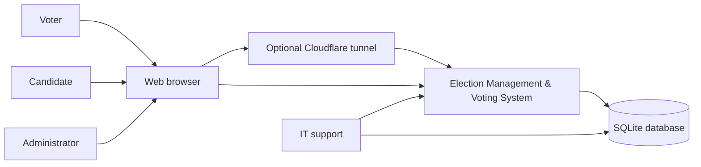
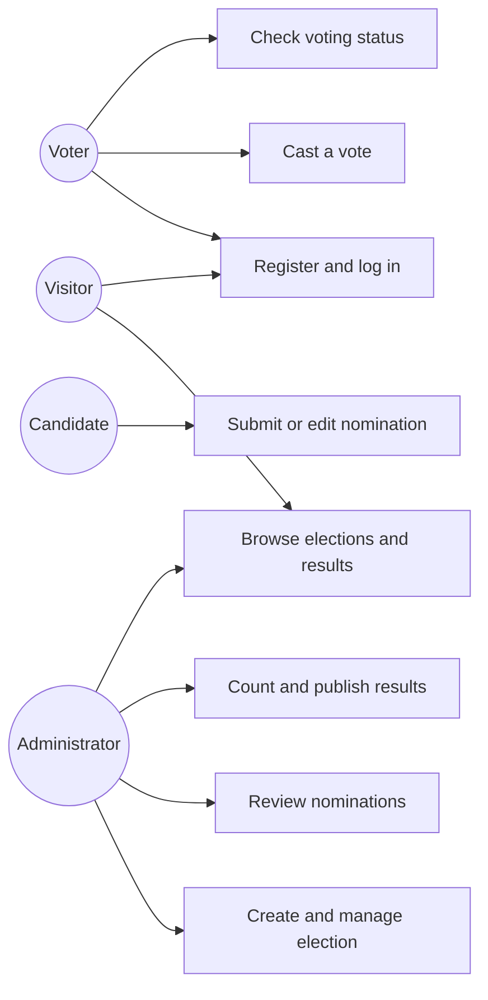
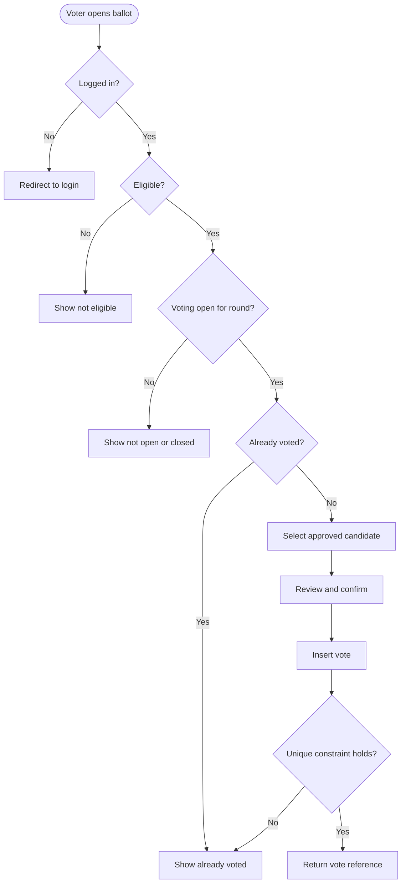
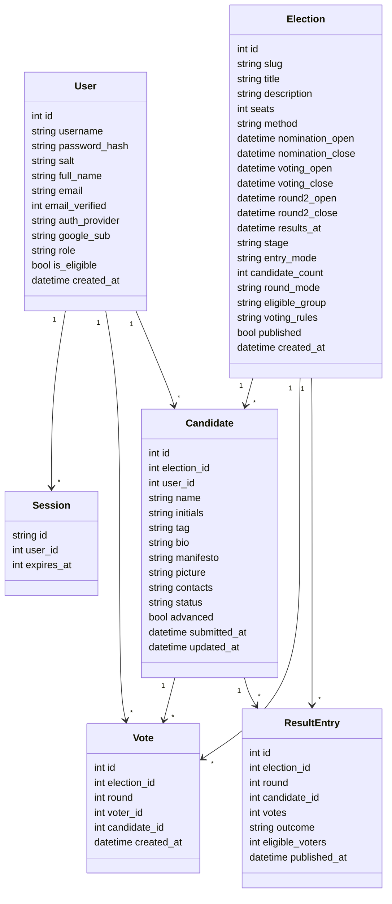
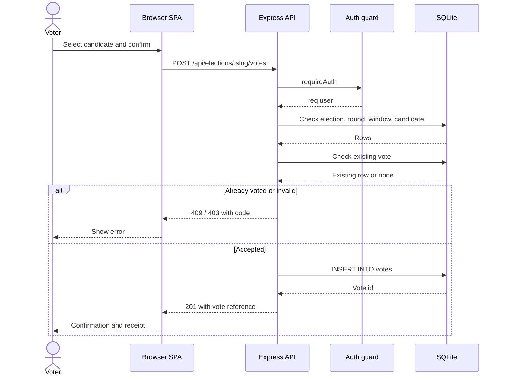
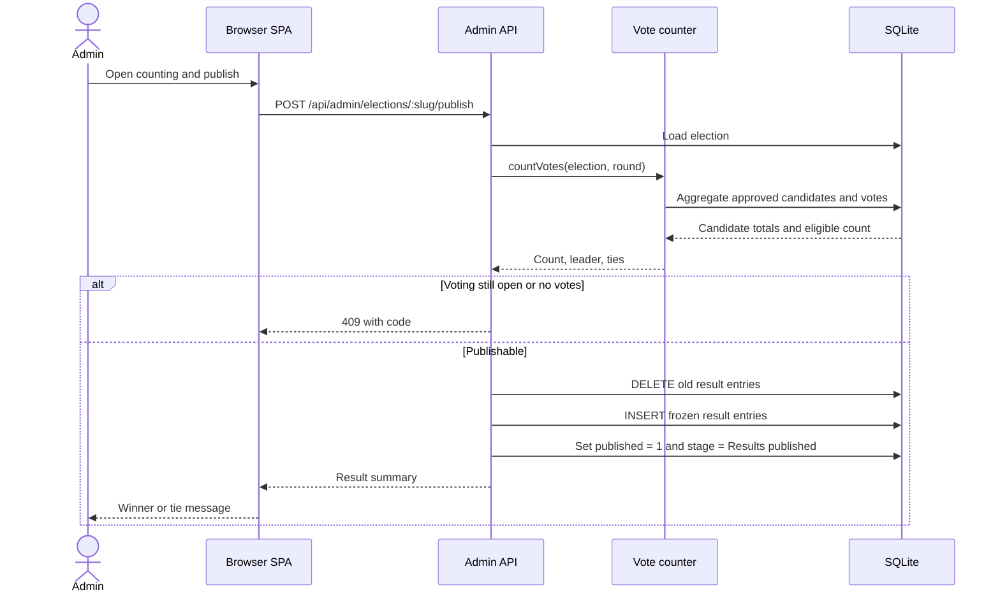
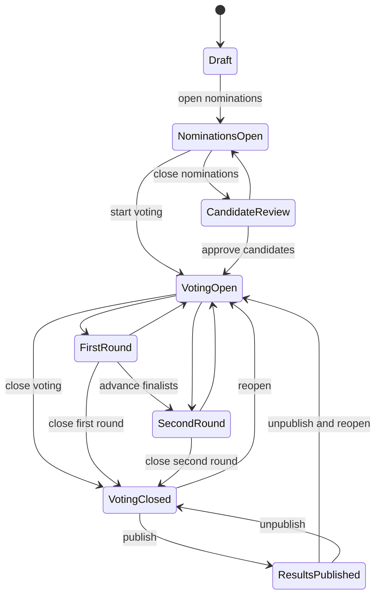
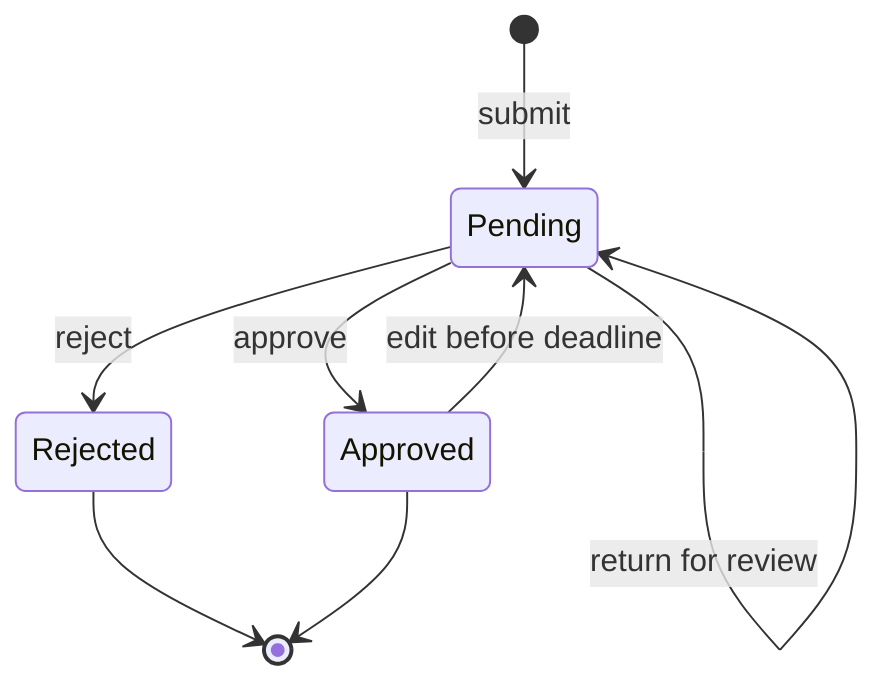

# System Models

These models follow the four perspectives from the system-modeling lecture: context, interaction, structure, and behaviour. They are intentionally lightweight and should be updated when requirements change.

## 1. Context model

The system boundary includes the web application, the SQLite database, and the optional public tunnel. External actors are the voter, candidate, administrator, and the browser.

## 2. Use-case model

## 3. Activity model: casting a vote

## 4. Class model

## 5. Sequence model: vote submission

## 6. Sequence model: publish results

## 7. State model: election lifecycle

State names are displayed with spaces in the UI; this diagram uses compact names for readability.

## 8. State model: nomination review

## 9. Model-to-code mapping

| Model | Code artifact |
|---|---|
| Context | `server/app.js`, `start-public.ps1` |
| Use cases | `app.js` route handlers and `server/routes/*.js` |
| Class model | `server/db.js` schema |
| Vote sequence | `server/routes/votes.js` |
| Publish sequence | `server/routes/admin.js`, `server/helpers.js` |
| Election state | `server/helpers.js` `electionStatus()`, `server/routes/admin.js` transitions |
| Nomination state | `server/routes/nominations.js`, `server/routes/admin.js` |
